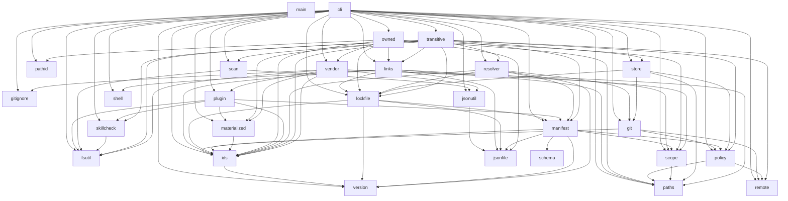
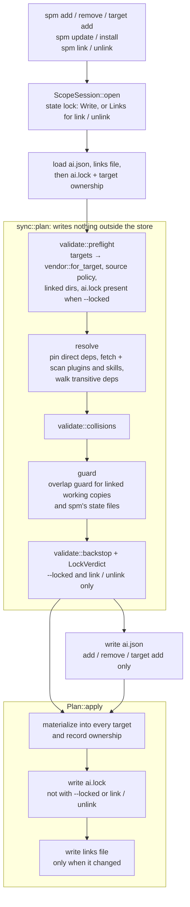
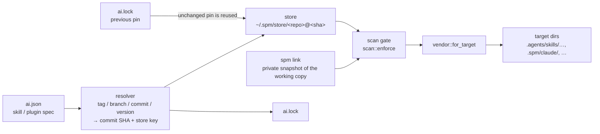

# Architecture

How spm's source is put together, for contributors. For the user-facing model,
see [How It Works](/guide/how-it-works); for the principles behind it, see
[Design Notes](/guide/design-notes).

## Module layering

Every top-level module under `src/` and the modules it is allowed to depend on
(`a --> b`: `a` uses `b`). `cli` is the top of the stack and the leaves at the
bottom depend on nothing else in the crate. `main` is the entry point: it
declares the modules and calls into `cli` without a `crate::` path, so it has no
edges here.

The graph is pinned: `tests/cli/architecture.rs` derives the real module graph
from the source and fails when it differs from its `ALLOWED_EDGES` table, when
it has a cycle, or when the diagram below differs from that table. After a
deliberate layering change, update `ALLOWED_EDGES` and regenerate the diagram
with `SPM_BLESS=1 cargo test module_graph_diagram` (the failing test also prints
the expected block).

<!-- module-graph: generated from ALLOWED_EDGES in tests/cli/architecture.rs; regenerate with `SPM_BLESS=1 cargo test module_graph_diagram` -->

## Command flow

Every command that changes a scope — `add`, `remove`, `update`, `install`,
`target add`, `link` and `unlink` — runs the same path through `src/cli/`. It
first opens a `ScopeSession` (`src/cli/session.rs`), the only way to take the
scope's state lock, and holds it until its last write, so nothing it read can
change underneath it. The shared sync pipeline (`src/cli/sync/`) then plans
everything without writing outside the global store, and only a fully checked
plan is applied.

- **`ai.json` is written only after the plan succeeds**, so a failed `add` (an
  unreachable source, a bad ref, a blocked scan, …) leaves it untouched and the
  command can be retried.
- **`ai.lock` is written only after every target is materialized**, so it never
  pins state that was not installed. `--lock-only` skips materialization and
  writes `ai.lock` alone.
- `spm doctor` runs the same plan read-only and offline (`LockMode::Check`) and
  reports its verdict instead of applying it.

## Install data flow

How a dependency travels from `ai.json` into the directory a tool loads it from,
during the `resolve` and `apply` phases above.

1. **Resolve.** Each direct dependency keeps its `ai.lock` pin when its spec is
   unchanged; otherwise `resolver` resolves the spec to an immutable commit SHA
   and store key (`--locked` never re-resolves).
2. **Fetch.** `store` makes sure `<repo>@<sha>` is checked out in the global
   store, cloning it at most once per commit. A dependency overridden with
   `spm link` is read from a private snapshot of its working copy instead.
3. **Scan.** Every skill and plugin passes the `scan` content gate before it can
   be materialized. With `resolveTransitive` on, each fetched skill's own
   `ai.json` is read too, and its dependencies go through the same
   resolve → fetch → scan steps (see
   [Transitive Dependencies](/guide/transitive-dependencies)).
4. **Materialize.** `vendor::for_target` picks the adapter for each target in
   `ai.json`, which copies the scanned content where that tool loads it from —
   see [Targets & Vendors](/guide/targets).
